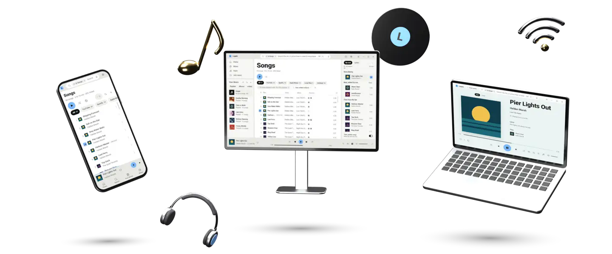

# Legato

**One library and one player for YouTube Music, Spotify, Apple Music and your own files.**

Windows 10 and 11 · free · no account of ours

<picture>
  <source media="(prefers-color-scheme: dark)" srcset="site/public/landing/float-dark.svg">
  
</picture>

## Get it

Download `Legato_…_x64-setup.exe` from the [latest release](https://github.com/legato-app/legato/releases/latest) and run it.

## Everything else is on the website

What it does, how each service plays, what leaves your PC, which file to download, Windows' SmartScreen warning,
Stable or Beta, the FAQ: **<https://legato-app.github.io/legato/>** (its source is `site/`).

## Community

Questions, ideas and news: [join the Discord](https://discord.gg/WsqAuCSxQU), or use
[GitHub Discussions](https://github.com/legato-app/legato/discussions).

## Contributing

Build from source, the checks and the conventions: [CONTRIBUTING.md](CONTRIBUTING.md) and [docs/](docs/README.md).

## License

Source-available, not open source. You may use the app for free. Issues and pull requests are welcome; changing the
code for any other purpose, or reusing any part of it in another project, requires the author's written permission.
See [LICENSE](LICENSE).
